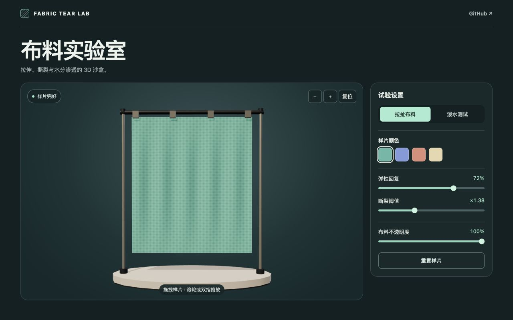
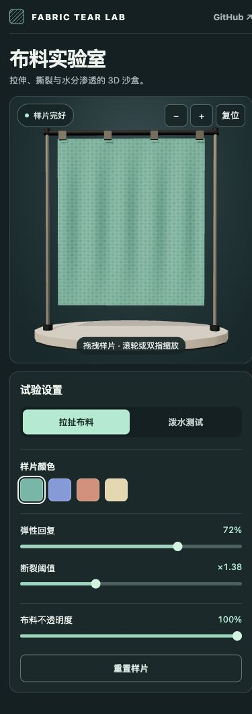

# Fabric Tear Lab · 布料实验室

在浏览器里用鼠标或触屏拉扯一块 3D 布料，观察网格变形、断裂和水分扩散。桌面和移动设备使用同一套控制参数。

[](https://app.netlify.com/start/deploy?repository=https%3A%2F%2Fgithub.com%2FMartinDelophy%2Ffabric-tear-lab)

## 预览

| 桌面 | 手机 |
| --- | --- |
|  |  |

## 操作

- **拉扯布料**：按住并拖动样片。拉伸超过阈值时，布料会撕裂。点击「重置样片」恢复。
- **泼水测试**：点击布料，观察水滴和湿痕。调整单次水量，或点击「清除水分」。
- **缩放视图**：滚轮、双指或场景右上角按钮均可缩放。

## 本地运行

使用 Node.js 22 或更新版本。

```sh
npm ci
npm run dev
```

`npm run build` 生成 `dist/`。从 GitHub 将仓库导入 Netlify 时，`netlify.toml` 会配置构建命令和发布目录。

## 许可

本仓库的应用代码和生成的演示素材采用 [MIT 许可](LICENSE)。布料、支架、织纹和水滴均由代码生成。[Three.js](https://github.com/mrdoob/three.js) 作为布料场景的渲染依赖，使用其自身的 MIT 许可。
