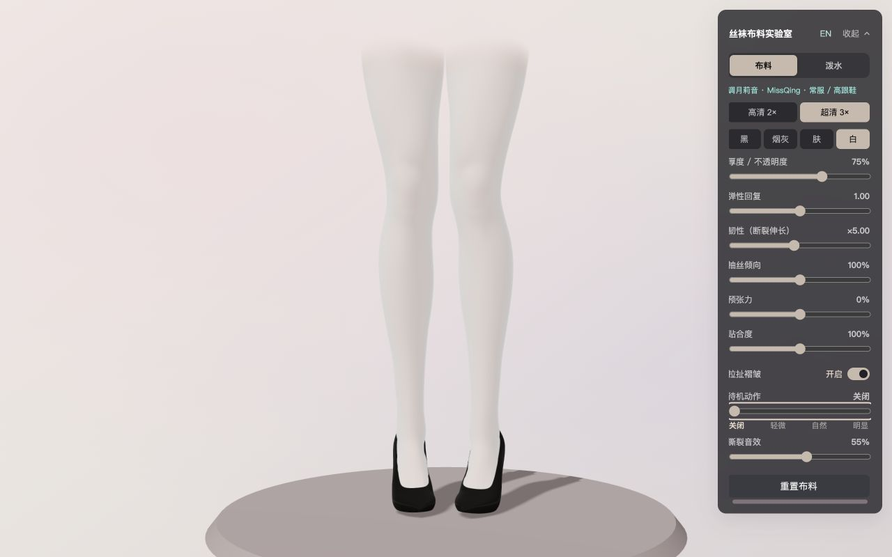

# Fabric Tear Lab · 丝袜布料实验室

[在线体验](https://fabric-tear-lab.netlify.app/) · [线上版源码与本地运行](https://github.com/MartinDelophy/fabric-tear-lab/tree/fabric-tear-4183#readme) · [v0.1.0](https://github.com/MartinDelophy/fabric-tear-lab/tree/v0.1.0)

在电脑或手机的浏览器里拖动 3D 袜面，观察布料拉伸、起褶和撕裂。切换到泼水模式后，点按袜面可观察水滴流动和湿痕扩散。

| 电脑 · 布料模式 | 手机 · 快捷工具栏 |
| :---: | :---: |
|  |  |

## 操作

- **布料**：按住袜面向外拖动。可调整颜色、厚度、弹性和韧性，或点击「重置布料」。
- **泼水**：切换模式后点按袜面。可调水量、透明度和黏度，或点击「清除水分」。
- **镜头**：电脑用滚轮缩放，手机用双指缩放和平移。界面支持中英文切换。

线上版由 Netlify 部署，浏览器从[参考站](https://fabric-tear.vercel.app/)加载模型、贴图和音频。模型作者为 [MissQing](https://booth.pm/en/items/6727723)。

## 早期布料样片

早期挂架样片的代码位于 `main`。使用 Node.js 22+，运行 `npm ci` 和 `npm run dev` 即可本地体验。该原型的应用代码和生成素材采用 [MIT 许可](LICENSE)。[查看早期版本与预览](https://github.com/MartinDelophy/fabric-tear-lab/tree/a802e91#readme)。
