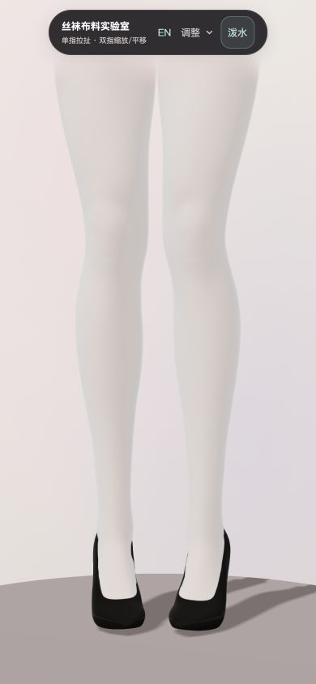

# Fabric Tear Lab · 丝袜布料实验室

[在线体验](https://fabric-tear-lab.netlify.app/) · [v0.1.1](https://github.com/MartinDelophy/fabric-tear-lab/tree/v0.1.1)

同一套网页适配电脑和手机，复现参考站的 3D 布料拉扯与泼水实验。桌面端显示右侧参数面板，手机端在顶部提供快捷工具，展开后从底部调节参数。

| 电脑 · 布料模式 | 手机 · 快捷工具栏 |
| :---: | :---: |
|  |  |

线上版由 Netlify 从 `fabric-tear-4183` 分支部署。浏览器从原站加载模型、贴图和音频。

## 在本地运行

使用 Node.js 22 或更新版本。在项目目录执行：

```sh
npm run assets
npm start
```

打开 [http://127.0.0.1:4173/](http://127.0.0.1:4173/)。首次运行 `assets` 需要联网，脚本会从参考站获取并校验指定版本的模型、网格、贴图和音频；资源保存后，预览不需要联网，也不需要安装 npm 依赖。如果使用已经准备好资源的本机项目，可以直接运行 `npm start`。端口占用时可用 `npm start -- --port 4183`。

## 操作

- **布料**：从袜面按住向外拖动，观察拉伸和破口。可调颜色、厚度、弹性、韧性，并重置布料。
- **泼水**：切换模式后点按袜面。可调液体颜色、透明度、用量、黏度等；使用「清除水分」回到干燥状态。
- **镜头**：PC 用鼠标滚轮缩放；H5 界面支持双指缩放和平移。顶部可切换中英文。

## 相关项目 · 雨丝 2.0

雨丝 2.0（Wet Denier Lab）是适配电脑和手机的 3D 泼水互动实验。点按模型可以泼水，按住拖动可以连续浇水。还可以切换影棚、浴室、夜雨街头和泳池边，在「衣橱」里调整姿势、袜款、材质和花纹。

[雨丝 2.0 的 GitHub 仓库](https://github.com/MartinDelophy/yusi-wet-denier-lab) · [在线体验](https://yusi-wet-denier-lab.netlify.app/)

## 编辑与构建

- `src/main.js`：参数、响应式工具栏和应用状态。
- `src/styles.css`：桌面与手机布局。
- `src/runtime.js`：参考站前端运行包里的 3D 渲染与仿真部分，保留运行逻辑。

需要 Vite 热更新或构建时，运行 `npm ci`，然后执行 `npm run dev` 或 `npm run build`。静态构建在 `dist/client/`；带模型的本地构建应按素材许可使用。

参考：[原站](https://fabric-tear.vercel.app/) · 模型：[MissQing / 调月莉音](https://booth.pm/en/items/6727723)。原作者禁止模型用于商业用途或再分发；源码 ZIP 因此不内置第三方模型和关联资源。
